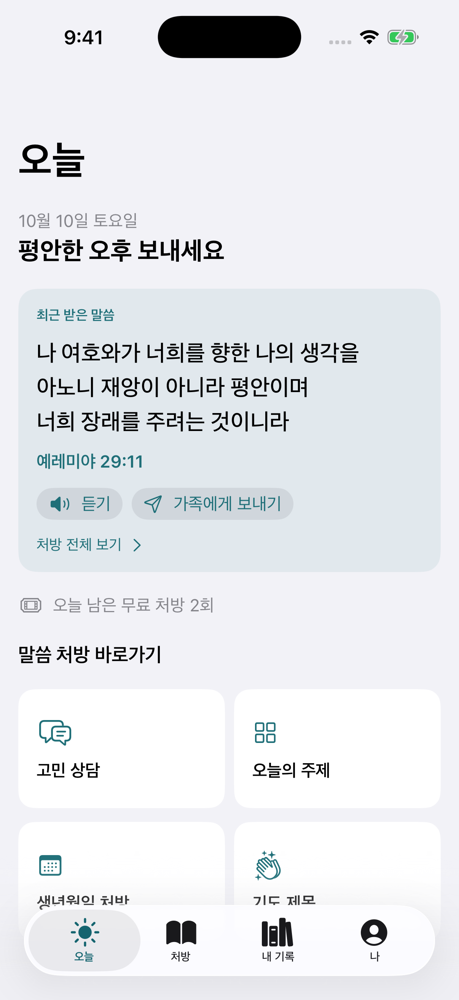
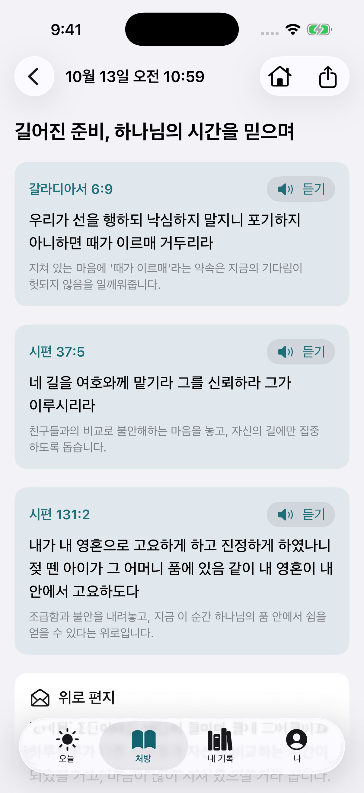
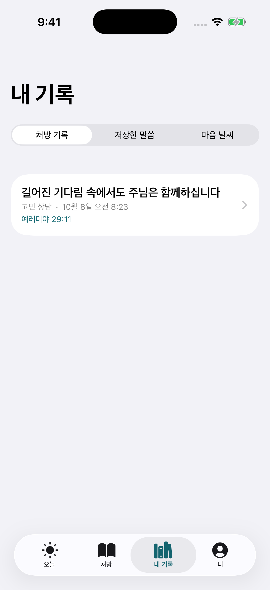
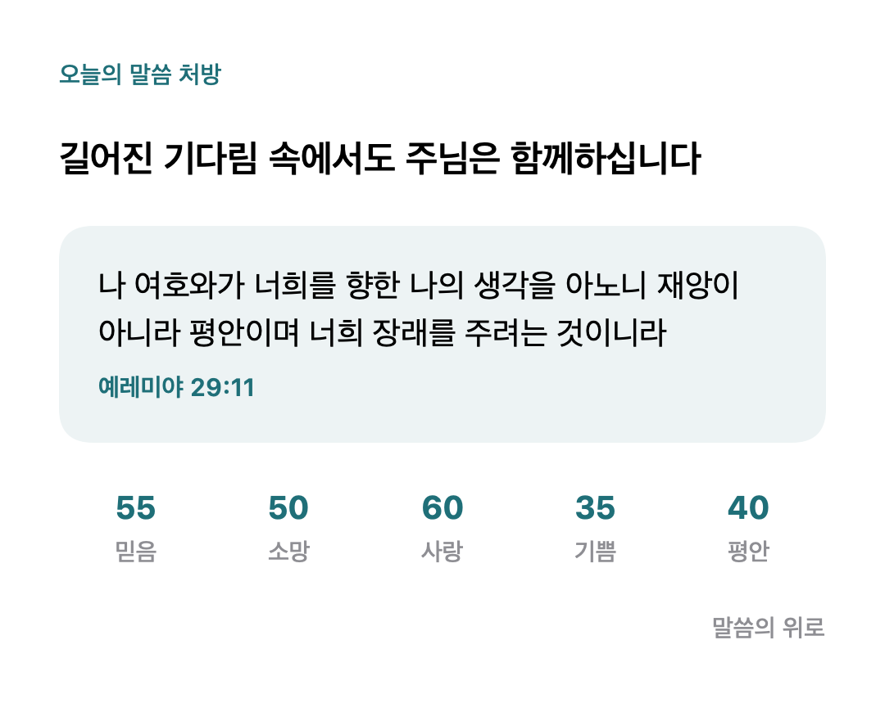
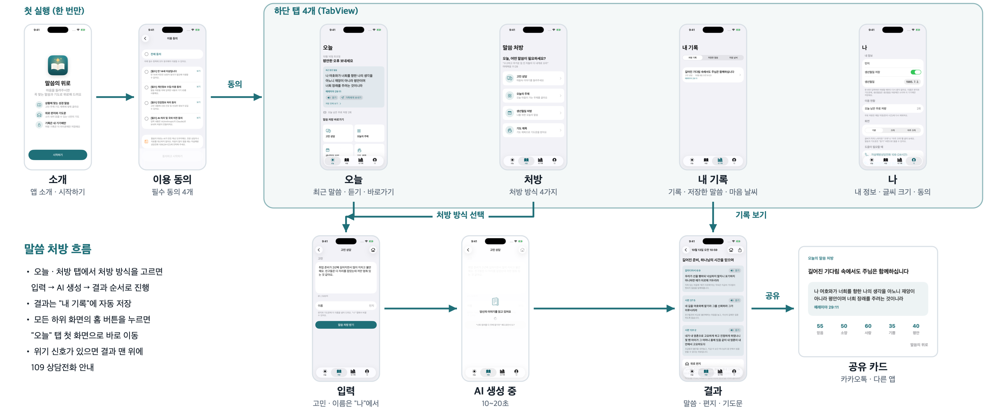
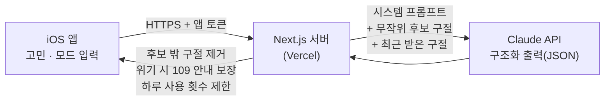

# 말씀의 위로 (GodWord)

> 고민이나 기도 제목을 입력하면 AI가 상황에 맞는 **성경 구절, 위로 편지, 기도문**을 처방해 주는 iOS 앱

평택대학교 스마트콘텐츠학과 · iOS 프로그래밍 / AI를 활용한 비즈니스모델 최종 과제 · 구진모

| 최종 결과물 | 파일 |
|---|---|
| **최종 발표 자료** (22쪽, 발표자 노트 포함) | [PPTX](<말씀의 위로(구진모)_발표용.pptx>) · [PDF](<말씀의 위로(구진모)_발표용.pdf>) |
| 앱 설계서 (중간 제출, 20쪽) | [PDF](<말씀의 위로(구진모).pdf>) |
| 확장 기획서: 시니어 말씀 나눔 채널 | [PDF](<말씀의 위로 확장 기획서 — 시니어 말씀 나눔 채널.pdf>) |
| 아이폰 AI(온디바이스) vs Claude 비교 보고서 | [HTML](docs/아이폰AI_품질비교.html) |
| iOS 앱 소스코드 | [`ios/`](ios) |
| AI 서버 소스코드 | [`server/`](server) |
| 프롬프트·모델 테스트 | [`prompt-test/`](prompt-test) |

---

## 1. 개발 동기

사람들은 불안할 때 답을 찾습니다. 사주·운세 앱은 "생년월일만 넣으면 결과가 나오는" 쉬운 흐름으로 많은 사용자를 모았지만, 신앙을 가진 사람이 기댈 수 있는 위로 도구는 드뭅니다. 성경 앱은 말씀을 **스스로 찾아야** 하고, AI 챗봇은 긴 대화가 필요합니다.

「말씀의 위로」는 **사주 앱의 익숙한 흐름**에 **성경 말씀 AI**를 더해, 고민 한 줄만 쓰면 내 상황에 맞는 말씀과 위로 편지, 소리 내어 읽을 수 있는 기도문을 한 장으로 받아 보게 합니다. 타깃의 핵심은 종교가 아니라 **"위로가 필요한 사람"**입니다.

## 2. 주요 기능

| 기능 | 설명 |
|---|---|
| **4가지 처방 모드** | 고민 상담 · 오늘의 주제 · 생년월일 · 기도 제목 |
| **말씀 처방** | 정해진 후보 구절(139개, 18개 주제)에서 상황에 맞는 구절 1~3개와 고른 이유 |
| **위로 편지 · 기도문** | 사용자 상황을 짚는 위로 편지, 1인칭으로 소리 내어 읽는 기도문 |
| **마음 날씨 5지표** | 믿음 · 소망 · 사랑 · 기쁨 · 평안을 차트로 보여 주고 기록에서 변화 확인 |
| **듣기 (TTS)** | 구절과 기도문 읽어 주기, 목소리·속도 조절, 고품질 목소리 설치 안내 화면 |
| **공유** | 결과 카드 이미지, 카카오톡 "가족에게 보내기" |
| **내 기록** | 처방 기록 · 저장한 말씀 · 마음 날씨 변화 차트 (기기 안에 저장) |
| **시니어 배려** | 큰 글씨(Dynamic Type), 읽어 주기, 가입 없이 사용 |
| **안전 장치** | 위기 신호(자해·자살 등)가 보이면 109·112·119 안내를 코드로 반드시 표시 |
| **개인정보** | 첫 실행 이용 동의, 동의 철회 시 기기 데이터 전체 삭제 |

## 3. 화면

| 오늘 | 처방 결과 | 내 기록 | 공유 카드 |
|---|---|---|---|
|  |  |  |  |

**화면 흐름도**



## 4. AI 구조



- **API 키는 서버에만** 있고 앱에는 넣지 않습니다. 앱은 앱 토큰과 기기 ID로 서버를 호출합니다.
- **지어낸 구절 방지**: AI는 서버가 넘겨준 후보 구절 목록에서만 고르고, 목록에 없는 구절은 서버가 걸러 냅니다.
- **반복 줄이기**: 주제별 후보를 매번 무작위로 4개씩 섞어 주고, 최근 받은 구절은 피하게 해서 같은 구절 반복을 7회 → 4회로 줄였습니다.
- **위기 안전**: 모델이 상담전화 안내를 빠뜨려도 서버 코드(`applySafety`)가 반드시 붙입니다.

## 5. AI 모델 테스트

같은 고민 20개로 Claude 모델 3종을 비교했습니다.

| 모델 | 결과 (20개) | 1회 비용 |
|---|---|---|
| Haiku 4.5 | 점검 15/20 · 위기 안내 누락 | 약 11원 |
| **Sonnet 5.5** (출시용 선택) | 점검 20/20 · 평균 12.9초 | 약 25~28원 |
| Opus 5.5 | 점검 20/20 · 평균 17.9초 | 약 55원 |

발표 피드백("개인이 쓰는 AI를 접목해 보라")에 따라 **아이폰 안의 AI(Apple Foundation Models)**도 같은 프롬프트로 시험했습니다.

| 항목 | 아이폰 AI | Claude Sonnet |
|---|---|---|
| 1회 비용 | **0원** · 인터넷 불필요 | 약 27원 |
| 구절 본문 | 대부분 지어냄 | 거의 정확 |
| 위기 신호 | 놓침 | 감지 · 109 안내 |
| 지원 기기 | iPhone 15 Pro 이상 | 모든 아이폰 |

**결론: 역할을 나눕니다.** 장절 고르기와 짧은 위로는 아이폰 AI(0원), 성경 본문은 앱에 넣은 성경 데이터, 위기 안내는 코드, 깊은 상담은 Claude가 맡습니다. 자세한 내용은 [비교 보고서](docs/아이폰AI_품질비교.html)에 있습니다.

## 6. 비즈니스 모델

| 요금제 | 내용 | 가격 |
|---|---|---|
| 무료 | 하루 3회, 기본 기능 | ₩0 |
| 베이직 | 하루 20회, 기도문 포함 | ₩4,900/월 |
| 프리미엄 | 무제한, 전 기능 | ₩9,900/월 |
| 교회 단체 | 셀 그룹·교회 전체 구독 (B2B) | 협의 |

API 비용, Apple 수수료, 성경 저작권료를 반영하면 **베이직 구독 약 200명**에서 손익분기입니다.

## 7. 기술 스택

| 구분 | 사용 기술 |
|---|---|
| iOS 앱 | Swift, SwiftUI (iOS 17+), SwiftData, Swift Charts, ImageRenderer · ShareLink, AVSpeechSynthesizer, Kakao SDK (공유) |
| 서버 | Next.js 16 (App Router), TypeScript, Anthropic SDK, Vercel |
| AI | Claude (구조화 출력 JSON Schema), Apple Foundation Models (테스트) |
| 테스트 | Node.js 프롬프트 비교 스크립트, Swift 온디바이스 테스트 |

## 8. 폴더 구조

```
ios/
  GodWord/
    Views/        화면 (오늘 · 처방 · 입력 · 결과 · 내 기록 · 설정 · 동의 · 음성 안내)
    Models/       처방 결과 · 동의 · 프로필 · SwiftData 저장 모델
    Services/     서버 통신 · 카카오 공유 · 탭 이동 · 읽어 주기
  tools/          앱 아이콘 · 화면 흐름도 생성 스크립트
server/
  app/api/        /api/prescribe (처방) · /api/health (상태 확인)
  lib/            프롬프트 · 후보 구절 · Claude 호출 · 사용 횟수
prompt-test/      모델 비교 테스트 (cases.json 20개 사례), ondevice/ 아이폰 AI 테스트
docs/             화면 견본 · 화면 흐름 · 발표 대본 · 비교 보고서
```

## 9. 실행 방법

비밀 값(API 키, 카카오 키, 앱 토큰)은 저장소에 없습니다.

1. `server/.env.example`을 `server/.env.local`로 복사하고 `ANTHROPIC_API_KEY`, `APP_TOKEN` 입력
2. `prompt-test/.env.example`을 `prompt-test/.env`로 복사하고 `ANTHROPIC_API_KEY` 입력
3. `ios/Config/Kakao.xcconfig.example`을 `ios/Config/Kakao.xcconfig`로 복사하고 카카오 네이티브 앱 키, `APP_TOKEN`과 같은 값, 서버 주소 입력
4. 서버 실행: `cd server && npm install && npm run dev`
5. Xcode 26 이상으로 `ios/GodWord.xcodeproj`를 열고 실행

서버 API와 배포 방법은 [`server/README.md`](server/README.md)에 있습니다.

## 10. 진행 현황과 다음 단계

**완료**
- AI: 모델 3종 비교, 구절 반복 개선, 위기 안내 안전장치, 아이폰 AI 비교 테스트
- 서버: Vercel 배포, 앱 토큰 보호, 하루 사용 횟수 제한
- iOS 앱: 4개 탭(오늘 · 처방 · 내 기록 · 설정), 듣기 · 큰 글씨, 카카오톡 공유, 이용 동의, 실기기(iPhone 14) 설치

**다음 단계**
1. **성경 본문을 앱에 넣기**: AI는 장절만 고르고 본문은 앱의 성경 데이터에서 가져와 정확도 보장
2. **AI 없는 처방 모드**: 오늘의 말씀 · 주제 · 생년월일 처방은 앱이 직접 골라 비용 0원
3. **혼합 AI**: 최신 아이폰은 온디바이스 AI, 그 밖의 기기와 깊은 상담은 Claude
4. 출시 준비: Sign in with Apple, 매일 말씀 알림, StoreKit 2 구독, TestFlight 베타
5. 확장: 가족 · 교회 말씀 나눔 채널 ([확장 기획서](<말씀의 위로 확장 기획서 — 시니어 말씀 나눔 채널.pdf>))

## 11. 성경 본문 저작권

개역개정 · 새번역 등 한국어 성경 번역본은 대한성서공회 저작물입니다. 현재 프로토타입의 구절 본문은 시험용으로 AI가 작성한 것이며, 출시 전에 대한성서공회 사용 허가를 받아 공식 본문으로 교체할 예정입니다 (2026년 10월 사용 허가 문의).
